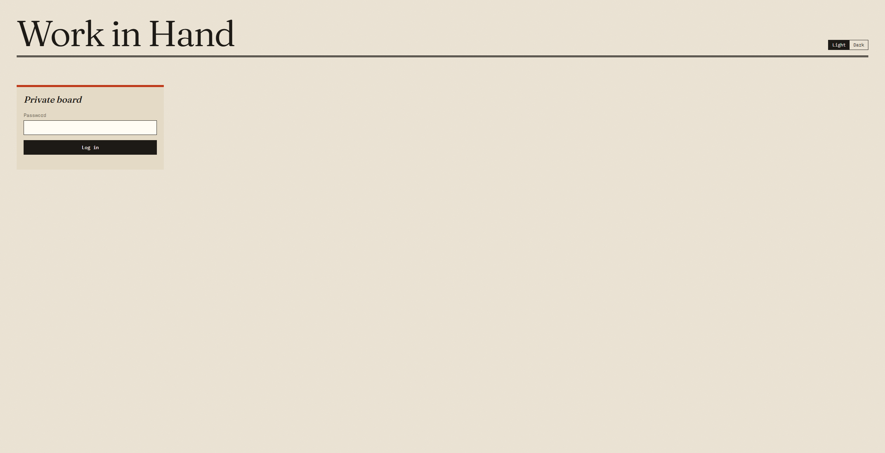
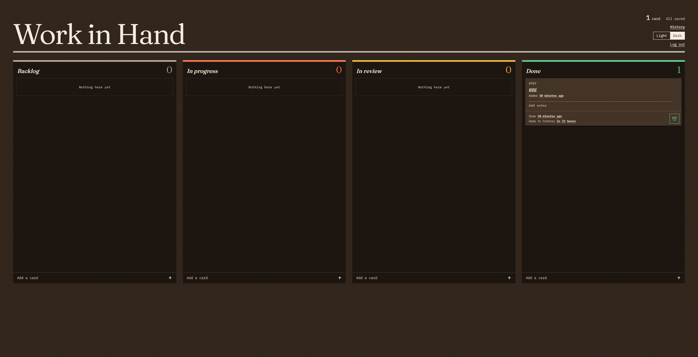
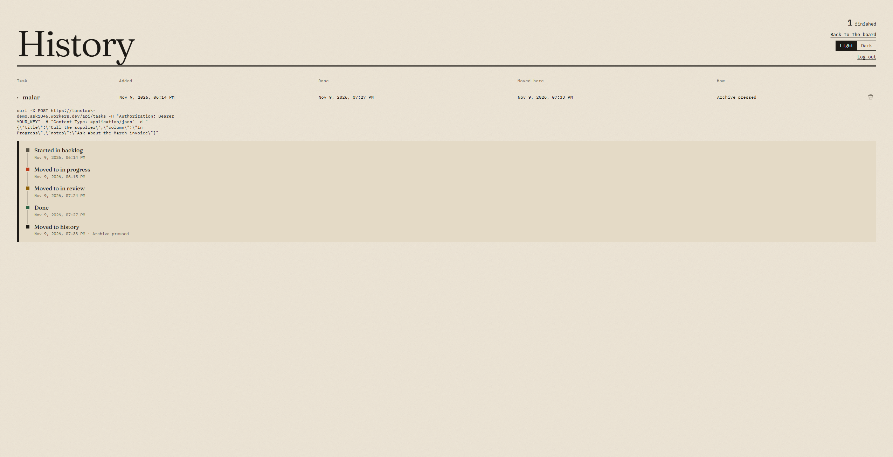

# Work in Hand

A private Kanban board that runs entirely on Cloudflare. Drag cards between Backlog, In progress, In review and Done, keep detailed notes on each one, and let other apps such as a voice assistant add and update cards through an API.

**Live demo:** https://tanstack-demo-public.ask1846.workers.dev

The demo needs no login and is shared by everyone who opens it, so please don't add anything private. Cards are deleted 10 minutes after they're added, and there's room for 9 at a time, counting History. Once 9 are in use, adding cards is turned off until the oldest one is deleted. The API, the MCP server and login are switched off there.

> [!IMPORTANT]
> **The public demo uses browser fingerprinting for safety.** Each visit and change on https://tanstack-demo-public.ask1846.workers.dev is logged with:
>
> - a browser fingerprint from the free, open-source [FingerprintJS](https://github.com/fingerprintjs/fingerprintjs)
> - the device (for example iPhone, Android phone, Mac or Windows PC), system and browser, read from the user agent
> - the date and time, and any text written on a card
>
> The log is kept in its own table, apart from the board, is never shown on the site, and is deleted after 30 days. The private site doesn't collect any of this.

## Screenshots

| Login | Board |
|---|---|
|  |  |

| History | Page not found |
|---|---|
|  |  |

## Features

- Drag and drop with instant updates that undo themselves if a save fails
- Editable titles and up to 5,000 characters of notes on every card
- A timeline of when each card moved, and relative times with the exact time on hover or tap
- Done cards move to History after 24 hours, or sooner with one click
- Light and dark themes
- Password login that stays signed in for a year
- A [REST API](docs/API.md) with filters, for voice commands, scripts and dashboards
- An [MCP server](docs/MCP.md) at `/mcp`, so AI agents such as Claude, Cursor and VS Code can read and change cards

## Built with

TanStack Start, React 19, TanStack Query, dnd-kit, Zod and TypeScript, on Cloudflare Workers with a SQLite-backed Durable Object.

## Getting started

You need Node.js 24 or newer.

```bash
npm install
```

```bash
npm run dev
```

Open http://localhost:3000. Login is skipped in this mode, and the data is local to your computer.

To try the API locally, copy `.dev.vars.example` to `.dev.vars`, set `API_KEY` to at least 32 characters, and restart. Git ignores `.dev.vars`, so it won't be committed.

## Commands

| Command | What it does |
|---|---|
| `npm run dev` | Starts the app on port 3000 |
| `npm run build` | Builds for production |
| `npm run preview` | Serves the production build locally |
| `npm run deploy` | Builds and deploys the private site to Cloudflare |
| `npm run deploy:demo` | Builds and deploys the separate public demo |
| `npm run cf-typegen` | Regenerates Cloudflare types after a `wrangler.jsonc` change |
| `npx vitest run` | Runs the tests |
| `npx vitest run --coverage` | Runs the tests with coverage |
| `npx tsc --noEmit` | Checks types |

## Deploying

The first time, sign in to Cloudflare:

```bash
npx wrangler login
```

The app needs two secrets:

| Secret | Purpose | Minimum length |
|---|---|---|
| `APP_PASSWORD` | The website's login password | 12 characters |
| `API_KEY` | The key other apps use for the API | 32 characters |

Generate a strong API key:

```bash
node -e "console.log(require('crypto').randomBytes(32).toString('hex'))"
```

Save each secret, pasting the value when asked:

```bash
npx wrangler secret put APP_PASSWORD
```

```bash
npx wrangler secret put API_KEY
```

Then deploy:

```bash
npm run deploy
```

Without `APP_PASSWORD`, nobody can sign in. Without `API_KEY`, the API refuses every call. Changing the password signs every browser out.

## Using the API

The API only runs on your own deployment, not on the public demo. Replace `YOUR-SITE` with your Worker's address.

Add a card:

```bash
curl -X POST "https://YOUR-SITE.workers.dev/api/tasks" \
  -H "Authorization: Bearer YOUR_KEY" \
  -H "Content-Type: application/json" \
  -d '{"title":"Call the supplier","column":"In Progress","notes":"Ask about the March invoice"}'
```

List completed cards:

```bash
curl "https://YOUR-SITE.workers.dev/api/tasks?status=completed" -H "Authorization: Bearer YOUR_KEY"
```

The [API reference](docs/API.md) covers every endpoint, filter and error.

## Testing a production build locally

`npm run dev` skips the login, so use this to test sign-in or the Cloudflare runtime:

1. Run `npm run build`.
2. Create `dist/server/.dev.vars` with test values for `APP_PASSWORD` and `API_KEY`.
3. Run `npx vite preview --port 3100`.

The next build clears `dist`, so repeat step 2 after rebuilding.

## Documentation

- [API reference](docs/API.md): for connecting other apps
- [Connecting AI agents](docs/MCP.md): MCP setup for Claude, Cursor, VS Code and others
- [Code guide](docs/ARCHITECTURE.md): how the code is organised and how to change it
