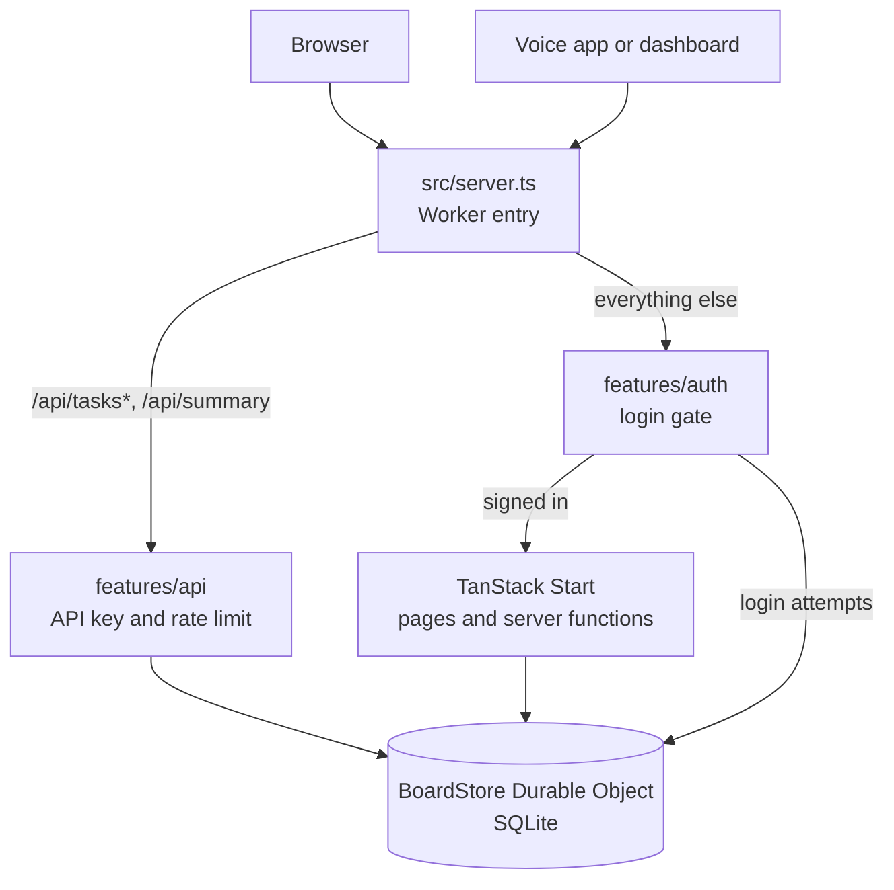

# Code guide

How the app is put together, for anyone changing it. For setup, see the [README](../README.md). For calling the API from another app, see the [API reference](API.md).

## The big picture

One Cloudflare Worker serves everything. All data lives in one SQLite-backed Durable Object, so every change happens in a single, strictly ordered place.

`src/server.ts` decides the route in this order:

1. API paths go to `handleTaskApi`, which uses the API key and never the login.
2. `npm run dev` on `localhost` skips the login.
3. `checkRequest` handles login and logout, and turns away anyone without a valid session.
4. Everything else goes to TanStack Start.

## Folders

| Path | What's there |
|---|---|
| `src/server.ts` | Worker entry and top-level routing |
| `src/start.ts` | TanStack middleware: security headers, cross-site checks, request size |
| `src/routes/` | Pages: board (`/`), history (`/history`), login (`/login`) |
| `src/features/board/` | The board: model, reducer, storage, UI |
| `src/features/auth/` | Password login, session cookie, attempt limits |
| `src/features/api/` | The public REST API |
| `src/lib/` | The small SQL interface and its two implementations |

`*.server.ts` files only run on the server. Tests sit next to the file they cover.

## Board changes

Every change to the board is a **command**, such as `move`, `create`, `set-title`, `set-notes`, `delete` or `archive`, defined in `board-model.ts`. Commands are validated with Zod.

The pure function `applyCommand` in `board-reducer.ts` is the only code that decides what a command does, and both sides run it:

- **In the browser**, `useOptimisticBoard` in `board-queries.ts` replays unsaved commands over the last confirmed board, so a change shows instantly.
- **On the server**, `apply` in `board-repository.server.ts` runs the same function inside a transaction and saves the difference.

Saves run one at a time, in order. A failed command stops being pending and drops out of the replay, so rollback needs no snapshots and can't undo a newer change.

The server always replaces the time on a command with its own clock.

### Adding a command

1. Add it to `boardCommandSchema` in `board-model.ts`.
2. Handle it in `applyCommand`. TypeScript flags the switch until you do.
3. Add its failure message to `FAILURE_MESSAGES` in `BoardView.tsx`. TypeScript flags this too.
4. If it changes a stored field, make sure `saveTasks` or `saveChangedNotes` writes that field.

## Storage

`board-repository.server.ts` holds the storage logic and depends only on the `SqlDatabase` interface in `src/lib/sql-database.ts`. In production that interface is `durable-object-sql.server.ts`. In tests it is `node-sql-database.testing.ts`, which uses Node's built-in SQLite, so the real SQL runs without Cloudflare.

| Table | Holds |
|---|---|
| `tasks` | Title, column, position, times, and archive state. History is rows with `archived_at` set |
| `task_notes` | One row per card that has notes. Kept apart so older databases needed no change to `tasks` |
| `task_moves` | Every column a card landed in, for its timeline |
| `login_attempts` | Failed-login counts per client, and one overall row keyed `*` |

Things to know:

- Durable Object SQL has no `BEGIN` or `SAVEPOINT`. Use `db.transaction`, and don't nest it: code inside a transaction calls `applyChange`, not `apply`.
- Durable Object methods here are synchronous, so calls can't interleave.
- Cards in Done move to History 24 hours after `done_at`. There's no scheduled job. `archiveExpiredTasks` runs before every read and write.
- Use `?` placeholders for values. The only SQL built from input is `ORDER BY`, chosen from the fixed `SORT_COLUMNS` map.
- Missing tables are created at start-up, in `setUpSchema` and `createLoginAttempts`. There's no migration tool.

## The public API

| File | Job |
|---|---|
| `task-api.server.ts` | Rate limit, API key, and the catch-all for errors |
| `task-api-routes.server.ts` | Paths, methods, handlers, and the JSON shape of a card |
| `task-api-schemas.ts` | Validation, column names, filters |
| `task-api-response.ts` | The `{success, data, error}` envelope |
| `board-task-queries.server.ts` | Filtered lists, single card, summary |
| `board-task-operations.server.ts` | Update, delete, archive |

The routes reach storage through the `TaskApiStore` interface, so they can be tested without a Durable Object. `getTaskApiStore` in `board-store.server.ts` supplies the real one.

API changes go through the same commands as the UI, so both follow the same rules.

### Adding an endpoint

1. Write the tests in `task-api-routes.server.test.ts`.
2. Add a query or operation in `board-task-*.server.ts`, with tests that use the real SQL.
3. Expose it as a method on `BoardStore`, in `getTaskApiStore`, and on `TaskApiStore`.
4. Add the route in `routesFor`. If the path is new, also update `isApiPath`, or the request goes to the login gate.
5. Update [API.md](API.md).

## Sign-in

- The password is the `APP_PASSWORD` secret, compared in constant time.
- A session is a signed cookie, `__Host-board-session`, lasting 365 days. It's keyed from the password, so **changing the password signs everyone out**.
- Each client gets 5 login attempts per 15 minutes, and all clients together get 30. An attempt is counted before the password is checked.
- `API_KEY` is a separate secret, so an outside app never holds the password.
- Without `APP_PASSWORD` nobody can sign in. Without `API_KEY` every API call is refused.

## Security headers

`request-security.server.ts` sets the headers for pages, including a per-request script nonce for the Content Security Policy in production. API and login responses set `no-store` and `nosniff` themselves.

## Front end

- `BoardView.tsx` owns the board page. `use-board-drag.ts` holds the drag and drop logic, using dnd-kit.
- `TaskEditor.tsx` is the title and notes dialog.
- `board.css` holds all the styles, with colours as CSS variables for the light and dark themes. `board-theme.ts` remembers the choice.
- `board-clock.ts` is a single shared timer that keeps relative times up to date.

## Tests

Tests use Vitest. The coverage threshold is 80%, set in `vitest.config.ts`. `board-store.server.ts` and `board-api.ts` are left out of coverage because they only run on Cloudflare and just forward calls.

Because the unit tests don't use the Cloudflare runtime, also try a change that touches `BoardStore` or `server.ts` on a local production build, as the README describes.

After changing `wrangler.jsonc`, run `npm run cf-typegen`.
